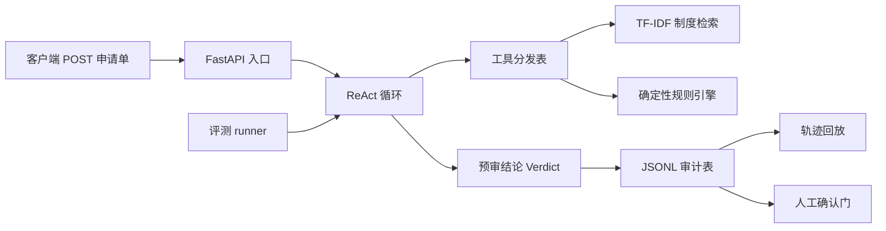

# approval-agent

> 变更申请单智能预审 Agent：一个可复跑、可评测、可审计的单 Agent 工程样例。

**English**: A pre-review service for data-export requests. It combines a deterministic rule engine, TF-IDF policy retrieval, a ReAct tool loop, a human approval gate, a JSONL audit trail and a 30-case evaluation harness. It runs end-to-end without an API key through a built-in mock decider.

## 这个项目解决什么

业务部门提交「数据导出申请」后，系统先做一次预审：查制度条款、跑确定性合规规则、给出**带依据的风险等级建议**，再交给人工确认。

V1 的安全红线：**所有申请仍走人工确认，不做自动放行**。Agent 输出的是建议，不是最终决定。

## 三条命令

```bash
uv sync                                                              # 装依赖（含 dev 组 pytest）
uv run python -m uvicorn app.main:app --host 127.0.0.1 --port 8000    # 起服务
uv run python -m app.eval.runner                                      # 跑评测
uv run python -m pytest -q                                            # 39 条单测
```

**无需任何密钥**：`.env` 里 `DEEPSEEK_API_KEY` 留空即自动走 mock 决策器，不联网、不消耗额度；填入 Key 才切换到真实模型（DeepSeek）。`.env.example` 是模板，`.env` 已被 `.gitignore` 屏蔽。

打开 `http://127.0.0.1:8000/docs` 可直接点 Try it out 走完整流程。

## 架构



分层：`app/knowledge/` 与 `app/rules/` 是不调 LLM 的资产层；`app/agent/` 是执行层（提示词、循环、工具分发表）；`app/governance/` 负责留痕与人工确认；`app/eval/` 消费这些数据做回归。

一个关键设计：**风险等级完全由确定性规则引擎决定，LLM 不参与分级**，只负责解释和引用依据。工具权限也握在代码手里——模型只能从 `TOOLS` 分发表里挑名字，挑到不存在的名字直接拒绝。

## 一次完整流程

1. `POST /applications` → `202`，返回 `request_id`、`mode` 和 `verdict`（等级 / 理由 / 依据 ID）。
2. `GET /requests/{request_id}` → 回放这次请求的完整轨迹（每步决策、工具返回、依据）。
3. `POST /review` → 人工提交最终决定；写一条 `actor="human"` 审计事件，重复提交返回 `409`，覆盖建议却没填理由返回 `422`。
4. 再查一次 `GET /requests/{id}`，状态从 `pending_review` 变为 `reviewed`。

审计落盘为 `logs/audit.jsonl`（每行一个 JSON），可通过 `request_id` 回放任意一次请求。`logs/` 与 `eval_results/` 都是运行产物，不进仓库。

## 评测结果（实测）

30 条人工标注用例，**按 corpus 里的制度条文独立标注**（不是照代码写答案），`gold_reasons` 填对应条款 / 判例 ID。生成命令：

```bash
uv run python -m app.eval.runner
```

首次运行会把结果固化为 `eval_results/baseline_mock.json`，之后每次回归打印与基线的差值。

| 指标 | mock 组实测 | 说明 |
| --- | --- | --- |
| 风险分级准确率 | **90.0%**（27/30） | 分类别：常规低风险 100%（9/9）、材料缺失 100%（7/7）、越权敏感 77.8%（7/9）、边界模糊 80.0%（4/5） |
| 漏判率 | **18.2%**（2/11） | 分母是标注为 high 的 11 条，安全红线 |
| 依据可追溯率 | **56.7%**（17/30） | 低风险用例没有依据 ID 是合理的，天然拉低此数；只测形式可追溯 |
| 平均工具调用轮数 | **1.57** | low 用例 1 次、mid/high 2 次 |
| 单均 token / 成本 | **0 / 0.0000** | mock 不产生真实 token，只有 live 组有成本意义 |

**3 条不一致全部可解释**：`S08` / `S09` 按 `policy#2.3`「导出非本部门归属的数据判高风险」标注，但 V1 规则引擎尚未实现跨部门条款 → 漏判；`B03` 字段名 `phone_model`（设备型号）被子串包含匹配误报为敏感字段。这两项是 V2 的明确待办。

**如实说明**：因为等级只由规则引擎决定，换提示词或换模型**不会改变准确率**，只会改变工具调用轮数与依据集合。本评测集 V1 的价值是建立可复跑基线、定位规则缺口，不是证明「模型效果好」。

## 已知限制（V1）

- `tokens` / `cost` 字段已留在审计事件里，但值恒为 0；真实成本归因未接 `response.usage`。
- 真实模式下网络异常已降级转人工（故障类型记入审计轨迹），但**不做重试**；重试与退避策略留到后续版本。
- 单测覆盖规则引擎、契约、循环三块共 39 条；**没有 HTTP 层单测**（`TestClient` 需要额外的 `httpx`）。
- 30 条用例只覆盖「常规低风险 / 材料缺失 / 越权敏感 / 边界模糊」四类；方案里的「提示词注入」类留到后续版本。
- 语料只有 8 条制度 / 判例，规模足够演示，不足以代表生产环境。
- `Verdict.need_human_review` 是 Agent 建议；系统策略层 V1 一律转人工。

## 目录结构

```
approval-agent/
├── app/
│   ├── main.py              # FastAPI 入口：提交 / 回放 / 复核
│   ├── schemas.py           # Pydantic 契约
│   ├── agent/
│   │   ├── prompts.py       # system prompt + 工具描述（用途/参数/返回）
│   │   ├── loop.py          # ReAct 循环 + trace 埋点
│   │   └── tools.py         # TOOLS 分发表 + 两个工具
│   ├── knowledge/           # TF-IDF 检索 + corpus.json（随仓库自带）
│   ├── rules/               # 确定性规则引擎，纯 Python
│   ├── governance/          # JSONL 留痕 + 人工确认门
│   └── eval/                # 30 条用例 + runner + 5 指标
├── tests/                   # 39 条单测
├── .env.example
├── .gitignore
├── pyproject.toml / uv.lock
└── LICENSE
```

## 许可

MIT
